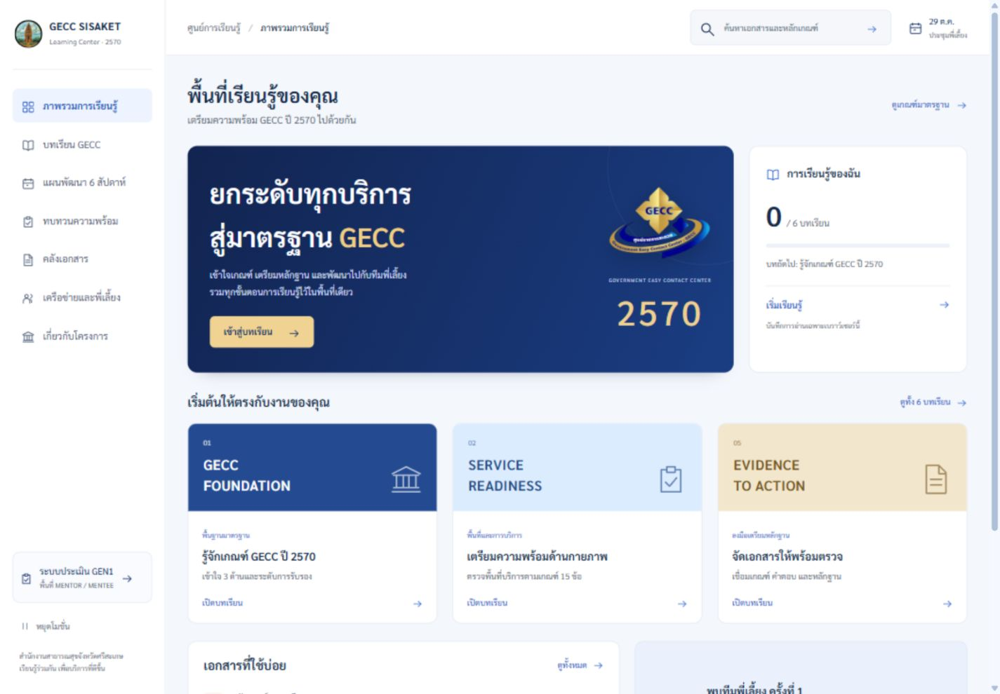
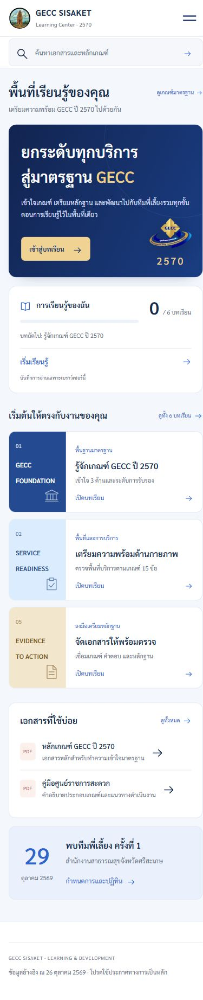

# Learning workspace review — 27 October 2026

The user rejected the first blue landing. This revision replaces its layout with a light learning workspace based on the supplied Claude / GEN1 reference: sidebar navigation, compact search header, navy and gold course introduction, real local reading progress, course shortcuts and document access. Sarabun is used throughout the main interface.

## Functional verification
- Six reading guides open independently, with official PDF sources and previous / next links.
- Marking lesson 1 as read survives a browser reload; undo was tested and test progress restored.
- Mobile menu opens, closes on route selection and includes access to assessment.
- Invalid nonnumeric lesson URLs return to the catalog; out-of-range numeric URLs show a recovery link.
- Global search opens the document library with the query applied (2570: 11 of 21 documents).
- Existing strategy dialogs, week tabs, readiness persistence, network tabs/search and GEN1 mentor demo flow were exercised earlier in this implementation; their underlying logic is preserved.
- 45 route / viewport combinations checked at widths 320, 390, 768, 1024 and 1440: no horizontal page overflow. Full results: responsive-workspace.json.
- Browser console: no errors captured during these checks.
- Static validator: 13 route IDs, 24 local HTML references, 7 document references, JavaScript syntax and original storage keys pass.

## Visual review
Desktop overview and mobile overview / reader were captured. Mobile hero logo clipping found during inspection was fixed; course cover icons no longer displace the titles. Sidebar scrolls on short desktop viewports.

## Scope and limitations
The six guides are editorial aids to reading the supplied GECC documents, not official new criteria, a scored examination or certification. Reading progress is local to the browser (gecc-learning-2570-v1). GEN1 still uses its original localStorage and IndexedDB simulation; PINs are demonstration role selection, not server authentication. No shared database, cross-user synchronization or AI service is connected. External Google/Canva resources retain their owners' access conditions. This verification is not a formal WCAG certification.

The earlier design directions and blue review are historical records and do not describe the delivered workspace. User approval of this revised design has not been asserted.
